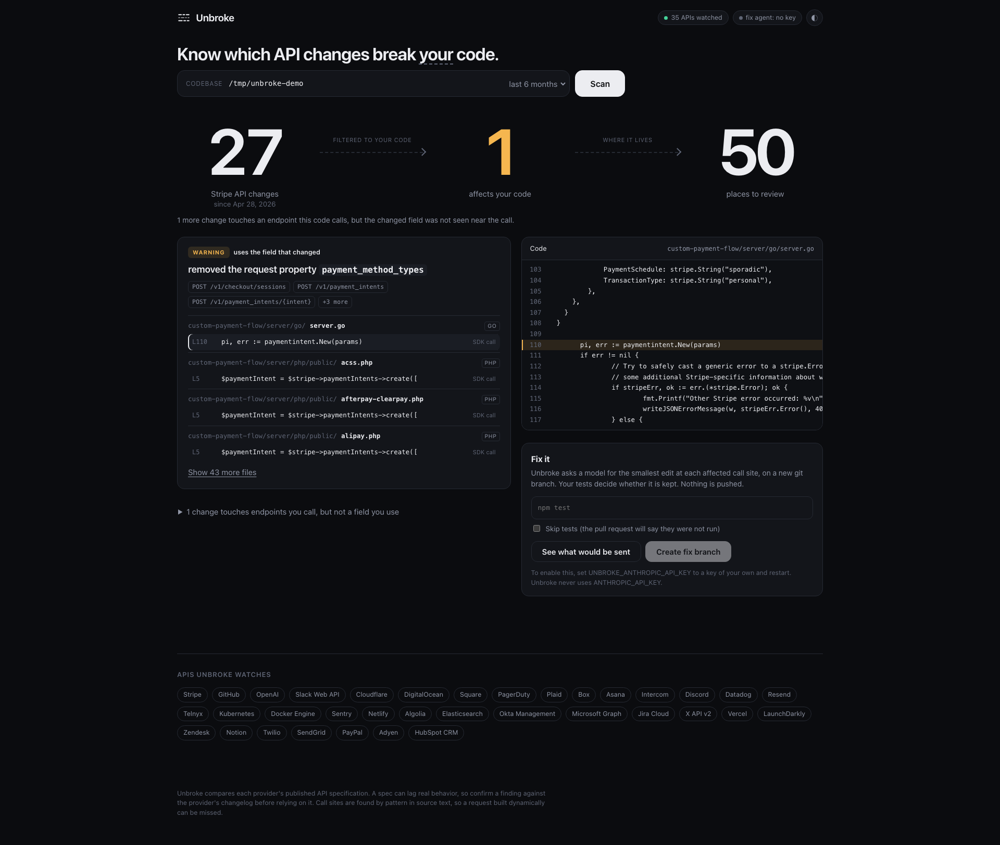

# Unbroke

Integrations that fix themselves.

Every product depends on other companies' APIs, and those APIs change: fields get renamed, endpoints retire, enums narrow. Usually the first sign is a customer reporting that something broke.

Unbroke watches the APIs your code depends on, works out which changes actually touch **your** code, and proposes the fix as a branch you can review, with your tests run before anything is kept.

```
$ unbroke scan stripe-samples/accept-a-payment

APIs used: Stripe (161 files)
Those APIs made 27 change(s) in the period; 1 affect this code, and 1 more touch endpoints it calls.

[WARNING] removed the request property `payment_method_types`
  POST /v1/checkout/sessions, POST /v1/payment_intents, POST /v1/payment_intents/{intent}, and 3 more
  this code uses the field that changed:
    custom-payment-flow/server/go/server.go:110   pi, err := paymentintent.New(params)   (sdk, medium, near `payment_method_types`, POST /v1/payment_intents)
    custom-payment-flow/server/php/public/acss.php:5   $paymentIntent = $stripe->paymentIntents->create([   (sdk, medium, near `payment_method_types`, ...)
    ... and 48 more call site(s)
```

That is real output from a public sample project: 27 changes in Stripe's API over six months, one of which matters to that code, found in 50 places across Go, PHP, Java, Ruby, Python, C#, JavaScript and TypeScript. Whether `payment_method_types` was really retired is for Stripe's changelog to confirm; Unbroke reports what the published specification says.

## The web interface

```bash
unbroke ui /path/to/your/project      # opens http://127.0.0.1:8787
```

The same scanner and fix agent, in a browser: type a path, watch it scan, see the funnel (API changes → ones that affect you → places to review), click a call site to see the code, and preview exactly what the model would receive before anything is sent.



Nothing in it is mocked; the screenshot is a real scan of a public Stripe sample. Because the interface can read files and change a repository, it listens on localhost only, rejects requests that are not addressed to a loopback name (which defeats DNS rebinding), and requires a random per-run token that only the page it serves holds, so another website cannot drive it.

## Commands

```bash
go build -o bin/unbroke ./cmd/unbroke

unbroke ui [repo]                     # the web interface
unbroke scan [repo]                   # which API changes affect this codebase
unbroke calls [repo]                  # which API endpoints this codebase calls at all
unbroke fix  [repo] -provider stripe -test "npm test"
                                   # propose the code changes on a new branch
unbroke changes stripe -since 6m      # everything that changed in one API
unbroke catalog list                  # the 35 APIs Unbroke watches
unbroke endpoints stripe -grep refund # a provider's endpoints
unbroke snapshot                      # save today's copy of specs that publish no history
unbroke diff old.yaml new.yaml        # compare any two OpenAPI files
```

`unbroke scan` finds out by itself which catalogued APIs the code uses (imports, dependency files, API hosts). `-fail-on warning` makes it exit with status 3 when something affects the code, for CI. [Running it in GitHub Actions](docs/github-action.md).

## How it decides what matters

1. **What changed.** Compares the provider's published OpenAPI spec now and six months ago, using [oasdiff](https://github.com/oasdiff/oasdiff)'s rules, then rates each change from the point of view of someone *calling* the API. A new value in a response is informational; a removed request field is a warning; a removed endpoint is breaking.
2. **Where you call it.** Finds calls three ways: a URL path in the code, a route string like `"GET /repos/{owner}/{repo}"`, or an SDK call like `stripe.refunds.create(`. Names shared by several endpoints (`sessions.create` is checkout, billing portal, and more) are resolved using the provider's full endpoint list, and a call is attributed to one only with evidence.
3. **Whether the changed field is used.** A removed request field matters only if your code sends it, so Unbroke looks for the field name next to the call. Calls where it can't see the field are listed separately and ranked lower.

Without step 2 and 3 a spec comparison is noise: run naively on two Stripe specs it reported 80,673 "breaking" changes.

## The fix agent

`unbroke fix` asks a model for the smallest edit at each affected call site. It is built to be hard to misuse:

- **It reads only `UNBROKE_ANTHROPIC_API_KEY`.** It deliberately ignores `ANTHROPIC_API_KEY` and friends, which are often set by an employer's tooling and point at a corporate gateway. Your code never goes through credentials you didn't choose.
- **Edits are literal replacements** of text that occurs exactly once in the file. A model that misremembers the code changes nothing.
- **Only files with findings are touched**, and paths outside the repository are refused.
- **You must say how to check the work:** `-test "<command>"` runs your tests and discards everything if they fail; `-no-tests` skips that and the pull request says so.
- **Nothing is pushed** unless you pass `-open-pr`, which needs a `GITHUB_TOKEN` you created.
- `-dry-run` shows exactly what would be sent to the model, and changes nothing.
- It shows the model the other fields added to the same endpoint, since the replacement for a removed field is usually among them.

## What has and hasn't been tested

- 15 Go packages with tests, including the git workflow (branch, commit, rollback when tests fail, refusal on a dirty tree) in real temporary repositories.
- **Scanner** run on real public projects. That caught two bugs a hand-made fixture could not: a DigitalOcean false positive from `godotenv`, and `Session.create` being attributed to every endpoint ending in `/sessions`. Both have regression tests.
- **Change engine** run on 28 providers' real history: 178 spec files, 0 failures. See [docs/benchmark.md](docs/benchmark.md). Nine spec files were malformed in the providers' own repositories, so only endpoint lists were compared for those.
- **The fix agent has been run end to end only against a stand-in model that makes a mechanical edit.** That proves the plumbing on a real repository (the request, applying the edit, the commit, ignoring the employer credentials), not the quality of a real model's fixes. That has yet to be measured.
- Pull request opening is tested against a fake GitHub server, not the real one.

## How well it finds your calls, API by API

The change engine works the same for all 35 APIs. Finding *your code's* calls to them depends on how that API is usually called, and it has been checked on real public projects for only some of them:

| How the API is usually called | Result on real projects |
|---|---|
| SDK or URL mirrors the REST names: Stripe, OpenAI, Twilio's official SDKs, raw GitHub URLs | Works. Stripe: 50 call sites across 8 languages. OpenAI quickstarts: 16 and 14 endpoints. GitHub (URLs built from a base + relative path): 36 endpoints. |
| Methods named after the operation (`CreateMessage`) | Matched by operation name; covered by tests, not yet seen in a real project. |
| A library with its own idioms: discord.js, discord.py, a third-party Twilio wrapper | **Not found.** These return zero calls, so "0 affect this code" is not evidence of safety for such a project. |
| Everything else in the catalog | Detected as used, but call-site matching is untested. |

`unbroke calls` lists the endpoints it can see, so you can check what it found before trusting a "0".

## Limits

- A spec comparison sees only what the provider documented.
- Call-site detection is pattern-based, and a name shared by several endpoints (for example `runs.create` for `/threads/runs` and `/threads/{id}/runs`) can be attributed to both. It reads source text and never runs it, so scanning untrusted code is safe, but a request built dynamically can be missed, and SDK calls are "medium" confidence.
- `unbroke changes` compares the same file path then and now. If a provider moved its spec file, the older version reads as "did not exist then".
- GitHub allows 60 unauthenticated history lookups an hour; set `GITHUB_TOKEN` for more. Results are cached.
- Not built: fixes for rarely-used SDKs beyond pattern matching, a hosted service, continuous watching beyond `unbroke snapshot` on a schedule.

## Layout

| Package | Job |
|---|---|
| `internal/catalog` | The APIs Unbroke watches and how to tell a codebase uses one |
| `internal/specdiff` | Compare two specs; rate, group, and fall back to endpoint-level comparison when a spec is malformed |
| `internal/track` | A provider's changes over a period, from git history or snapshots |
| `internal/scan` | Find where a codebase calls given endpoints |
| `internal/affect` | Join changes to call sites; is the changed field used? |
| `internal/fix` | Plan, prompt, apply, test, commit, describe, open a pull request |
| `internal/workflow` | The steps the command line and the web interface share |
| `internal/ui` | The local web interface and its API |
| `internal/llm` | The model client (reads `UNBROKE_*` variables only) |
| `internal/{fetch,history,snapshot,inventory,specload,change}` | Downloads, spec history, snapshots, endpoint lists, format handling, the shared record |

## Development

```bash
go test ./... -race
python3 scripts/benchmark.py            # re-run the six-month benchmark
bin/unbroke catalog verify -out catalog    # re-check every catalogued spec
```
