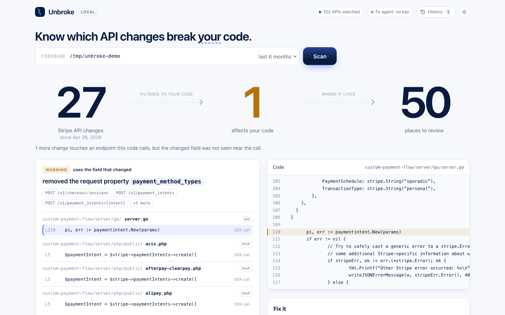
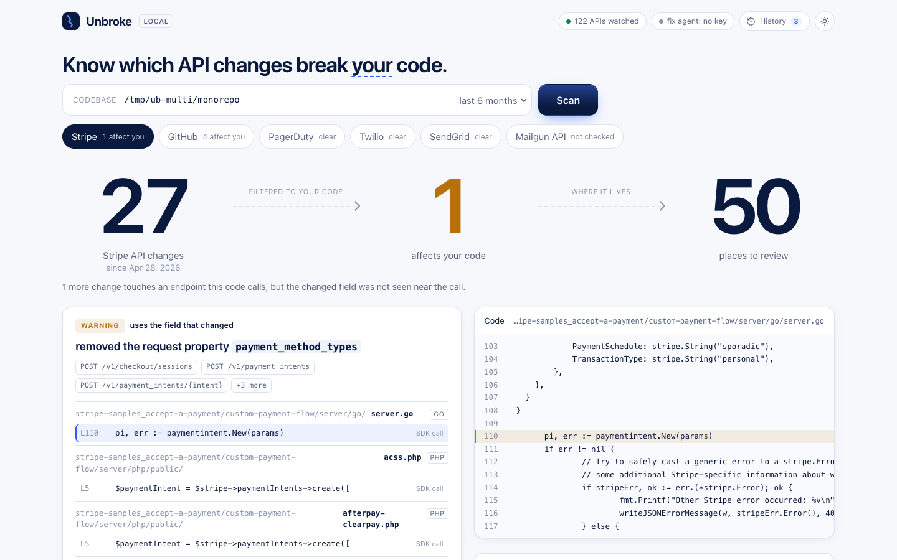
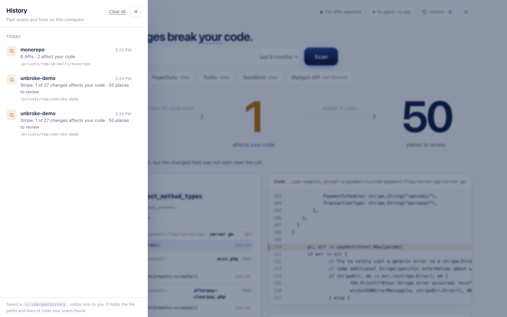

<div align="center">

# Unbroke

**Integrations that fix themselves.**

Know which third-party API changes break *your* code, and fix them before your customers notice.

[](https://github.com/yug/unbroke/actions/workflows/ci.yml)


[Website](https://unbroke.si) · [Quick start](#quick-start) · [Web interface](#the-web-interface) · [Command reference](#command-line-reference) · [The fix agent](#the-fix-agent) · [CI](#use-it-in-ci) · [FAQ](#troubleshooting)

</div>

---

Every product is built on other companies' APIs, and those APIs change: fields get renamed, endpoints retire, enums narrow. Usually the first sign is a customer reporting that something broke.

Unbroke watches the APIs your code depends on, works out which changes actually touch **your** code, shows you the exact lines, and can propose the fix as a branch you review, with your own tests run before anything is kept.

```console
$ unbroke scan ./accept-a-payment

APIs used: Stripe (161 files)
Those APIs made 27 change(s) in the period; 1 affect this code, and 1 more touch endpoints it calls.

== STRIPE ==  (compared with 2026-04-28)

[WARNING] removed the request property `payment_method_types`
  POST /v1/checkout/sessions, POST /v1/payment_intents, POST /v1/payment_intents/{intent}, and 3 more
  this code uses the field that changed:
    custom-payment-flow/server/go/server.go:110   pi, err := paymentintent.New(params)   (sdk, medium, near `payment_method_types`, POST /v1/payment_intents)
    custom-payment-flow/server/php/public/acss.php:5   $paymentIntent = $stripe->paymentIntents->create([   (sdk, medium, near `payment_method_types`, POST /v1/payment_intents)
    ... and 48 more call site(s)
```

That is real output from Stripe's public `accept-a-payment` sample: **27** changes in Stripe's API over six months, **1** that matters to that code, found in **50** places across Go, PHP, Java, Ruby, Python, C#, JavaScript and TypeScript. (Your numbers will differ as Stripe's API changes. Whether a field was really retired is for the provider's changelog to confirm; Unbroke reports what the published specification says.)

<picture>
  <source media="(prefers-color-scheme: dark)" srcset="docs/screenshots/ui-dark.png">
  
</picture>

## Contents

- [What it does](#what-it-does)
- [Install](#install)
- [Quick start](#quick-start)
- [The web interface](#the-web-interface)
- [Command-line reference](#command-line-reference)
- [The fix agent](#the-fix-agent)
- [Use it in CI](#use-it-in-ci)
- [Supported APIs](#supported-apis)
- [How it decides what matters](#how-it-decides-what-matters)
- [Privacy and where things are stored](#privacy-and-where-things-are-stored)
- [Status: what is tested and what is not](#status-what-is-tested-and-what-is-not)
- [Troubleshooting](#troubleshooting)
- [Contributing](#contributing)

## What it does

1. **Watch.** Reads each provider's published OpenAPI/Swagger specification and compares today's version with an earlier one (six months ago by default).
2. **Filter.** Keeps only the changes that touch endpoints your code calls, and, for removed fields, only those your code actually sends. Of Stripe's 27 changes above, 26 never reach you.
3. **Pinpoint.** Lists the files and lines, in the languages your project uses, with how confident the match is.
4. **Mend.** Optionally asks a model for the smallest edit at each place, on a new git branch, and keeps it only if your tests pass. Nothing is pushed unless you ask.

Unbroke is a single self-contained binary. The catalog of APIs and the web interface are built in; there is nothing to configure to scan.

## Install

**Requirements**

| | |
|---|---|
| [Go](https://go.dev/dl/) 1.26 or newer | Only to build it. With the default `GOTOOLCHAIN=auto`, an older Go downloads the exact toolchain this project pins (1.26.10) by itself. |
| `git` | Used to read each provider's spec history. |
| Internet access | To download specs. Scanning your code is local. |
| *Optional:* an Anthropic API key of your own | Only for the fix agent. Scanning and the web interface need none. |

Unbroke is developed on macOS and tested on Linux in CI. It builds for Windows, but that is untested.

**Option A: install with Go**

```bash
go install github.com/yug/unbroke/cmd/unbroke@latest
```

This puts `unbroke` in `$(go env GOPATH)/bin` (usually `~/go/bin`). Make sure that directory is on your `PATH`.

**Option B: build from source**

```bash
git clone https://github.com/yug/unbroke.git
cd unbroke
go build -o bin/unbroke ./cmd/unbroke
./bin/unbroke -h            # or move it onto your PATH: sudo mv bin/unbroke /usr/local/bin/
```

Check that it works:

```bash
unbroke catalog list | tail -3
```

## Quick start

Try it on a real public project. This takes about a minute the first time, because Unbroke downloads Stripe's spec and its history.

```bash
git clone https://github.com/stripe-samples/accept-a-payment
unbroke scan ./accept-a-payment
```

You will see which APIs the project uses, how many changes each made, and which of them affect the code. Then look at it in the browser:

```bash
unbroke ui ./accept-a-payment
```

Now point it at your own code:

```bash
cd /path/to/your/project
unbroke scan                  # detects the APIs you use by itself
unbroke scan -since 3m        # only the last three months
unbroke calls                 # which endpoints it can see you calling (check this before trusting a "0")
```

## The web interface

```bash
unbroke ui /path/to/your/project      # opens http://127.0.0.1:8787
```

The same scanner and fix agent as the command line, in a browser:

- **Type a path and press Scan.** It finds the APIs your code uses and compares each one.
- **The funnel** shows API changes → the ones that affect you → places to review. With several APIs, each gets a tab; one that could not be compared says *not checked* rather than *clear*.
- **Click a call site** to see the code around it, with the changed field highlighted.
- **Preview what would be sent.** *See what would be sent* shows, byte for byte, what the model would receive. Nothing is sent.
- **Fix it.** With `UNBROKE_ANTHROPIC_API_KEY` set before you start, *Create fix branch* runs the [fix agent](#the-fix-agent) and shows the diff and the pull request text.
- **History** lists your past scans and fix runs. Opening a scan shows its results again without rescanning; fixes are only offered from a fresh scan, so an edit always matches your code as it is now.
- **Light and dark mode.** It follows your system until you click the sun/moon button.

<table>
<tr>
<td width="50%"></td>
<td width="50%"></td>
</tr>
<tr>
<td align="center"><sub>One tab per API found in the code</sub></td>
<td align="center"><sub>History of past scans and fixes</sub></td>
</tr>
</table>

Because the interface can read files and change a repository, it is locked down: it listens on localhost only (`-addr` refuses anything else), rejects requests whose Host header is not a loopback name (which defeats DNS rebinding), and requires a random per-run token that only the page it serves holds, so another website cannot drive it. If port 8787 is busy it picks a free one and tells you.

## Command-line reference

Run `unbroke <command> -h` for any command's flags. Flags may come before or after the repository path, and the path defaults to the current directory.

| Command | What it does |
|---|---|
| `unbroke scan [repo]` | Which API changes affect this codebase. |
| `unbroke calls [repo]` | Which API endpoints this codebase calls at all. |
| `unbroke fix [repo]` | Propose the code changes on a new branch ([details](#the-fix-agent)). |
| `unbroke ui [repo]` | The [web interface](#the-web-interface). |
| `unbroke changes <api>` | Everything that changed in one API over a period. |
| `unbroke endpoints <api>` | One API's endpoints. |
| `unbroke diff <old> <new>` | Compare any two OpenAPI files, for APIs not in the catalog. |
| `unbroke catalog list` | The APIs Unbroke watches. |
| `unbroke catalog verify` | Download and parse every catalogued spec. |
| `unbroke snapshot [api...]` | Save today's copy of specs whose provider publishes no history. |

### `scan`

```bash
unbroke scan                                  # current directory, last six months
unbroke scan ./services/billing -since 1y     # a subfolder, a year back
unbroke scan -provider stripe,twilio          # only these APIs (default: detect from the code)
unbroke scan -min breaking                    # only breaking changes (info | warning | breaking)
unbroke scan -all                             # also list calls to changed endpoints where the field was not seen
unbroke scan -json | jq '.providers[].findings | length'
```

`-since` takes `90d`, `12w`, `6m` or `1y`. `unbroke scan` finds the APIs the project uses from imports, dependency files and API hosts.

**Exit status** (useful in scripts and CI):

| Code | Meaning |
|---|---|
| `0` | Success (or nothing at the `-fail-on` level affects the code). |
| `1` | Error. |
| `2` | Bad usage. |
| `3` | With `-fail-on warning` or `-fail-on breaking`: a change at that level affects the code. |
| `4` | With `-fail-on`: an API the code uses **could not be checked** (an archived spec, a failed download, no earlier version yet). A gate never passes without having looked. |

### `changes`, `endpoints`, `diff`

```bash
unbroke changes stripe -since 6m -summary     # one line of counts
unbroke changes github -min breaking -json    # machine-readable
unbroke changes twilio -spec api_v2010        # one spec file of a provider that has several
unbroke endpoints stripe -grep refund         # find an endpoint
unbroke diff old-openapi.yaml new-openapi.yaml -api "Internal Billing API"
```

### `snapshot`

Providers that host their own spec, with no public history, can only be compared from the first copy Unbroke saved. Run this on a schedule to build that history:

```bash
unbroke snapshot            # every such API
unbroke snapshot auth0 posthog
```

Snapshots are kept in `~/.unbroke/snapshots`. The first `scan`/`changes` for such an API says *saved the first snapshot; changes will show up on later runs*, which is expected.

## The fix agent

`unbroke fix` asks a model for the smallest edit at each affected call site, on a new branch. It is built to be hard to misuse.

### Set it up

1. Get an Anthropic API key **of your own** from the [Anthropic Console](https://console.anthropic.com/).
2. Export it (and, optionally, a model or gateway):

   ```bash
   export UNBROKE_ANTHROPIC_API_KEY="sk-ant-..."
   export UNBROKE_MODEL="claude-sonnet-5-5"            # optional; this is the default
   export UNBROKE_ANTHROPIC_BASE_URL="https://..."     # optional; default https://api.anthropic.com
   ```

3. Preview, then run, from a clean git checkout on a branch:

   ```bash
   unbroke fix -provider stripe -dry-run                    # show exactly what would be sent; change nothing
   unbroke fix -provider stripe -test "npm test"            # make the change; discard it if the tests fail
   git diff main...unbroke/stripe-2026-10-30                # review it like any pull request
   ```

   The branch is named `unbroke/<api>-<date>` unless you pass `-branch`.

| Flag | |
|---|---|
| `-test "<cmd>"` | Command that runs your tests. If they fail, **everything is discarded**. |
| `-no-tests` | Make the change without running tests; the pull request text says so. One of `-test`, `-no-tests` or `-dry-run` is required. |
| `-dry-run` | Show what would be sent to the model and change nothing. |
| `-provider <id>` | Which API to fix for (required if the code uses several). |
| `-max-files N` | Most files to change in one run (default 5). Run it again for the rest. |
| `-since`, `-min` | Same as `scan`. |
| `-branch`, `-base` | Branch name; branch a pull request targets. |
| `-pr-body <file>` | Also write the pull request description to a file. |
| `-open-pr` | Push the branch and open a pull request. Needs `GITHUB_TOKEN`. |
| `-allow-dirty` | Start with uncommitted changes (files you changed are still never edited). |

### What it promises

- **It reads only `UNBROKE_ANTHROPIC_API_KEY`.** It deliberately ignores `ANTHROPIC_API_KEY` and its relatives, which are often set by an employer's tooling and point at a corporate gateway. Your code never goes through credentials you didn't choose.
- **Edits are literal replacements** of text that occurs exactly once in the file. A model that misremembers the code changes nothing.
- **Only files with findings are touched.** Paths outside the repository and symlinks are refused, and a file with uncommitted changes is never edited.
- **You end up where you started.** The fix is committed on a new branch and you are returned to your branch with the working tree exactly as it was. If anything fails, including a cancelled run or a rejected commit hook, Unbroke writes back the exact bytes it read and deletes the branch. It refuses to start on a detached HEAD, with no commits, or without a git identity, *before* spending anything.
- **Nothing is pushed** unless you pass `-open-pr`.

## Use it in CI

Fail a scheduled job when an API change affects your code:

```yaml
name: unbroke
on:
  schedule:
    - cron: "17 6 * * 1"
  workflow_dispatch:
jobs:
  scan:
    runs-on: ubuntu-latest
    steps:
      - uses: actions/checkout@v4
      - uses: actions/setup-go@v5
        with:
          go-version: stable
      - run: go install github.com/yug/unbroke/cmd/unbroke@latest
      - run: unbroke scan -since 3m -fail-on warning .
        env:
          GITHUB_TOKEN: ${{ secrets.GITHUB_TOKEN }}   # only raises GitHub's rate limit
```

Exit status 3 means a change affects the code; 4 means an API could not be checked, so treat it as a failure or allow it explicitly. See **[docs/github-action.md](docs/github-action.md)** for the fuller recipes, including one that opens a pull request with the fix.

## Supported APIs

**122 public APIs**, 287 specification files and about 63,000 endpoints, every one downloaded and parsed by `unbroke catalog verify`. The full list, with endpoint counts and notes, is in **[catalog/catalog.md](catalog/catalog.md)**.

| Category | Examples |
|---|---|
| Payments & finance | Stripe, PayPal, Adyen, Square, Plaid, Xero, Chargebee, Mollie, Zuora |
| AI | OpenAI, Anthropic*, Mistral, Cohere, Hugging Face, ElevenLabs, Replicate |
| Cloud & DevOps | Cloudflare, DigitalOcean, Kubernetes, Docker, GitLab, Linode, CircleCI, Grafana |
| Communications & marketing | Twilio, SendGrid, Discord, Slack, Telnyx, Klaviyo, Mailgun, Sinch |
| Developer tools & collaboration | GitHub, Jira, Asana, Notion, Box, Figma, Trello, ClickUp |
| Identity & data | Okta, Auth0, WorkOS, MongoDB Atlas, PlanetScale, Supabase, Weaviate |
| CRM & support | HubSpot, Zendesk, Intercom, Pipedrive, Front |

\* Anthropic publishes no spec of its own; this is a community-maintained one.

`unbroke catalog list -category AI` filters the list.

**Two kinds of history.** For **68** APIs the spec lives in a public git repository, so any two past versions can be compared immediately. For **53** the provider hosts the spec itself, so Unbroke saves copies and compares from the first one onward (run `unbroke snapshot` regularly). Slack's spec was archived by Slack in 2021 and is reported as *not checked* rather than *no changes*.

**Not available.** An API can only be watched if it publishes a downloadable spec. Several big names don't: **Salesforce** (its Commerce Cloud specs sit in folders renamed with every release, its Marketing Cloud file dates from 2019, and its core API's spec is generated per customer), **Shopify** (GraphQL), **Zoom** (a 2018 file), **AWS**, **Google Cloud** and **Azure**. The catalog lists 76 such companies with the reason for each.

### Add an API

Add an entry to [`internal/catalog/providers.yaml`](internal/catalog/providers.yaml):

```yaml
  - id: example
    name: "Example"
    company: "Example Inc."
    category: "Payments"
    specs:
      - name: "REST API"
        repo: example/openapi          # a public GitHub repo with history...
        path: openapi/spec.yaml
        # url: "https://example.com/openapi.json"   # ...or a URL the provider hosts (use one of the two)
```

Then run `unbroke catalog verify -provider example` to confirm it downloads and parses. If the API's name is an everyday word (`merge`, `render`, `front`) or is shared with something more common (`mongodb`, `gitlab`), also give it specific signals (its SDK package names and API hosts) in [`internal/catalog/hints.go`](internal/catalog/hints.go), or it will be "detected" in unrelated projects; a test enforces this for the known cases.

## How it decides what matters

1. **What changed.** Compares the provider's spec now and then using [oasdiff](https://github.com/oasdiff/oasdiff)'s rules, and rates each change from the point of view of someone *calling* the API. A new value in a response is informational; a removed request field is a warning; a removed endpoint is breaking.
2. **Where you call it.** Finds calls three ways: a URL path in the code, a route string like `"GET /repos/{owner}/{repo}"`, or an SDK call like `stripe.refunds.create(`. Names shared by several endpoints (`sessions.create` is checkout, billing portal and more) are resolved using the provider's full endpoint list, and a call is attributed to one only with evidence.
3. **Whether the changed field is used.** A removed request field matters only if your code sends it, so Unbroke looks for the field name next to the call. Calls where it can't see the field are listed separately and ranked lower.

Without steps 2 and 3 a spec comparison is noise: run naively on two Stripe specs it reported 80,673 "breaking" changes.

It reads these file types: JavaScript/TypeScript (`.js .jsx .ts .tsx .mjs .cjs`), Python, Ruby, Go, Java, Kotlin, Scala, PHP, C#, Swift, Rust, Elixir, Dart, Lua, Perl, shell, Vue, Svelte, ERB/EJS, and config files (`.yml .toml .env .ini`), plus dependency files such as `package.json`, `requirements.txt`, `go.mod`, `Gemfile`, `composer.json`, `pom.xml` and `build.gradle`. Directories like `node_modules`, `vendor` and `.git` are skipped.

## Privacy and where things are stored

- **Scanning reads source text on your machine and never runs it.** Nothing about your code is uploaded.
- **The only network requests** are: downloading specs (from GitHub or the provider), GitHub history lookups, and, only when you run the fix agent, the model API you configured, plus GitHub's API if you pass `-open-pr`. There is no telemetry.
- **Your code leaves your machine only for `fix`**, and only the affected files, to the model you configured. `fix -dry-run` and the interface's *See what would be sent* show exactly what.

| Path | Holds |
|---|---|
| `~/.unbroke/snapshots` | Saved copies of specs that publish no history. |
| `~/.unbroke/history` | The web interface's past scans and fixes, readable only by you, last 50 kept. **It includes file paths and lines of your code**; use *Clear all* in the interface to wipe it. |
| `~/Library/Caches/unbroke` (macOS) or `~/.cache/unbroke` (Linux) | Downloaded specs and commit-only clones of providers' spec repositories. Safe to delete; it is rebuilt on demand. It can reach several hundred MB after watching many APIs (about 890 MB on the author's machine with all 122). |

## Status: what is tested and what is not

Unbroke is early. Here is what has actually been checked.

- **15 Go packages with tests**, run with the race detector in CI, including the git workflow (branch, commit, rollback when tests fail, refusal on a dirty tree) in real temporary repositories.
- **The change engine** was run on 27 providers' real history: 177 spec files, 0 failures, 1,418 breaking and 2,095 warning changes in six months. See **[docs/benchmark.md](docs/benchmark.md)**. The benchmark has not been re-run for the APIs added since.
- **The scanner** was run on real public projects, which caught two bugs a hand-made fixture could not (a false match from `godotenv`, and `Session.create` being attributed to every endpoint ending in `/sessions`). Both have regression tests.
- **The fix agent has been run end to end only against a stand-in model that makes a mechanical edit.** That proves the plumbing on a real repository, not the quality of a real model's fixes, which has not been measured yet. Pull-request opening is tested against a fake GitHub server, not the real one.

**How well it finds your calls depends on how the API is usually called:**

| How the API is called | On real projects |
|---|---|
| SDK or URL mirrors the REST names (Stripe, OpenAI, GitHub, Twilio's REST URLs) | Works. Stripe: 50 call sites across 8 languages. OpenAI quickstarts: 16 and 14 endpoints. GitHub: 36 endpoints. |
| Methods named after the operation (`CreateMessage`, Twilio's official SDKs) | Matched by operation name; covered by tests, not yet checked on a real project. |
| A library with its own idioms (discord.js, discord.py, third-party wrappers) | **Not found.** These return zero calls, so "0 affect this code" is not evidence of safety for such a project. |
| Every other API in the catalog | Detected as used; call-site matching is untested. |

Run `unbroke calls` to see which endpoints it can find before trusting a "0".

**Other limits**

- A spec comparison sees only what the provider documented, and specs can lag the real behavior. Confirm a finding against the provider's changelog.
- Some providers regenerate their spec wholesale (GitLab did in 2026), so a comparison can report far more changes than the live API made. Those entries carry a note in the catalog.
- Call-site detection is pattern-based. A request built dynamically can be missed, and a name shared by several endpoints can be attributed to more than one. SDK calls are "medium" confidence.
- Detection looks for an API's name in imports, URLs and dependency files, so a project that depends on a *library* from the same company (for example a protobuf helper) can be flagged for an API it doesn't call. The catalog guards the known cases.
- If a provider moves its spec file, versions from before the move read as "did not exist then".
- Not built: a hosted service, and continuous watching beyond running `unbroke snapshot` and `scan` on a schedule.

## Troubleshooting

**`GitHub rate limit reached`**: GitHub allows 60 unauthenticated lookups an hour. Set `GITHUB_TOKEN` (any token, no special permissions) to raise it. Unbroke caches answers, so reruns cost nothing.

**`saved the first snapshot of this spec; changes will show up on later runs`**: this API hosts its own spec with no public history. Unbroke has now saved its first copy; changes appear on later runs. Run `unbroke snapshot` weekly.

**An API shows *not checked* (or exit status 4)**: Unbroke could not compare it: an archived spec, a failed download, or no earlier version yet. It deliberately says so instead of reporting *no changes*.

**`No calls to a watched API were found`**: check the path points at the code that calls the API, and that the API is in `unbroke catalog list`. Detection needs an import, a dependency-file entry or an API URL.

**`0 affect this code`, but I use that API**: run `unbroke calls`. If your endpoints aren't listed, the library you use isn't recognised yet (see the [table above](#status-what-is-tested-and-what-is-not)).

**The *Create fix branch* button is disabled**: no model key was set. Export `UNBROKE_ANTHROPIC_API_KEY` and restart `unbroke ui`. *See what would be sent* works without one.

**`the working tree has uncommitted changes`**: commit or stash first, so the fix lands on top of a clean tree and can be undone cleanly.

**`127.0.0.1:8787 is in use`**: Unbroke picks a free port and prints the address. Or choose one: `unbroke ui -addr 127.0.0.1:9000`.

**Wrong Go version / `go: toolchain` messages**: install Go 1.26+, or leave `GOTOOLCHAIN` at its default (`auto`) so the pinned version downloads itself.

**The cache is large**: delete the cache folder listed [above](#privacy-and-where-things-are-stored); it is rebuilt on demand.

## Contributing

Issues and pull requests are welcome, especially:

- **A spec location for an API on the unfound list.** If a company publishes a stable, downloadable OpenAPI/Swagger file, [add it](#add-an-api).
- **Call-site detection for libraries it misses**, with a real project that shows the gap.
- **A real-model evaluation of the fix agent.**

```bash
git clone https://github.com/yug/unbroke.git && cd unbroke
go build -o bin/unbroke ./cmd/unbroke
test -z "$(gofmt -l .)"        # formatting
go vet ./...
go test ./... -race -count=1   # what CI runs
python3 scripts/benchmark.py   # re-run the six-month benchmark (needs network; takes a while)
bin/unbroke catalog verify -large -out catalog   # re-check every catalogued spec and rewrite catalog/
```

Run `catalog verify -out` for **all** providers, never with `-provider`, which would overwrite the report with a partial one. If you use an Anthropic key while developing, use your own and set only `UNBROKE_ANTHROPIC_API_KEY`.

### Project layout

| Package | Job |
|---|---|
| `cmd/unbroke` | The command line. |
| `internal/catalog` | The APIs Unbroke watches (`providers.yaml`) and how to tell a codebase uses one. |
| `internal/specdiff` | Compare two specs; rate, group, and fall back to endpoint-level comparison when a spec is malformed. |
| `internal/track` | A provider's changes over a period, from git history or snapshots. |
| `internal/scan` | Find where a codebase calls given endpoints. |
| `internal/affect` | Join changes to call sites; is the changed field used? |
| `internal/fix` | Plan, prompt, apply, test, commit, describe, open a pull request. |
| `internal/workflow` | The steps the command line and the web interface share. |
| `internal/ui` | The local web interface and its API (`web/index.html` is the page). |
| `internal/llm` | The model client; reads `UNBROKE_*` variables only. |
| `internal/{fetch,history,snapshot,inventory,specload,change}` | Downloads, spec history, snapshots, endpoint lists, format handling, the shared record. |
| `site/` | The marketing website (static; see [site/README.md](site/README.md)). |
| `catalog/`, `docs/`, `scripts/` | Generated API reports, documentation, the benchmark script. |

## Credits

Spec comparison is built on [oasdiff](https://github.com/oasdiff/oasdiff) and [kin-openapi](https://github.com/getkin/kin-openapi). Brand marks on the website come from [Simple Icons](https://simpleicons.org) (CC0) or each company's own site, and remain their owners' trademarks; they appear only to name the APIs Unbroke reads.
